  

  
  
  

## 🚀 About Me
- 🌱 I'm currently learning **Python, Machine Learning, Deep Learning, AI Agents.**
- 💬 Ask me about **AI & ML**
- 😄 Pronouns: **He/Him**

## 📉 Model Training

  

## 🛠️ Tech Stack

<h4 align="center">💻 Languages</h4>

  
  
  
  

<h4 align="center">🌐 Web</h4>

  
  

<h4 align="center">🗄️ Databases</h4>

  
  

<h4 align="center">🤖 AI / ML</h4>

  
  
  
  
  

<h4 align="center">🧰 Tools</h4>

  
  

## 📊 GitHub Stats

  

## 📈 Contribution Graph

  

  <b><i>"AI is the new electricity."</i></b> 
  — Andrew Ng

