  

  
  
  

## 🚀 About Me

  

## 📉 Model Training

  

## 🛠️ Tech Stack

  

## 📊 GitHub Stats

  

## 📈 Real GitHub Contribution Graph

  

## 🐍 Snake Contribution Animation

  

  <b><i>"AI is the new electricity."</i></b> 
  — Andrew Ng

